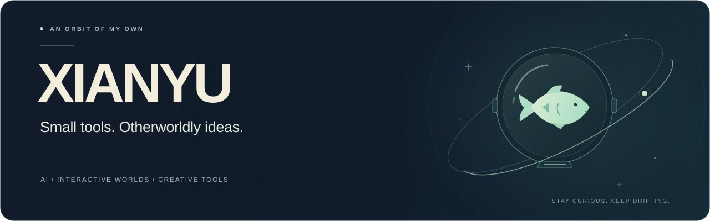

  

  <a href="https://xianyu-hw.github.io/ai-desktop-designer/?lang=en"><b>Explore the showcase ↗</b></a>
  &nbsp; · &nbsp;
  <a href="https://github.com/XIANYU-HW?tab=repositories">Browse projects</a>
  &nbsp; · &nbsp;
  <a href="#中文">中文</a>

### Hey, I'm XIANYU. 咸鱼宇航员 🛰️

I build with AI: **small tools, interactive desktop worlds, and clear ways to explore data.** This is where those experiments find a home.

把灵感做成能用的小工具，把喜欢的世界搬进日常。

---

## Selected work

### 01 / AI Desktop Designer

**A world you love. A desktop you can live in.**

An AI skill for designing interactive desktop worlds, with workflows for Windows and macOS. Artwork, motion, notes, focus timers, and everyday tools share the same scene.

<table>
  <tr>
    <td width="50%" valign="top">
      
       
      <b>Three-Body · Observatory</b> 
      A little order in an unpredictable world. 
      <a href="https://xianyu-hw.github.io/ai-desktop-designer/themes/threebody-observatory/?demo=1&amp;lang=en">Enter the observatory ↗</a>
    </td>
    <td width="50%" valign="top">
      
       
      <b>Sumeru · Garden of Knowledge</b> 
      A quiet place for thoughts to grow. 
      <a href="https://xianyu-hw.github.io/ai-desktop-designer/themes/genshin-sumeru/?demo=1&amp;lang=en">Step into the garden ↗</a>
    </td>
  </tr>
</table>

[**Explore the project →**](https://github.com/XIANYU-HW/ai-desktop-designer) &nbsp; · &nbsp; Python / HTML / CSS / JavaScript

Unofficial fan showcases. Browser demos use sample system data; they do not operate your computer.

### 02 / Frostbite Dashboard

**From demand signals to clearer inventory decisions.**

A supply-planning coursework project that brings forecasts, weeks of supply, and reorder recommendations into one readable dashboard.

[**View the project →**](https://github.com/XIANYU-HW/frostbite-dashboard) &nbsp; · &nbsp; HTML / CSS / SVG

---

## In my orbit

| Exploring | Making |
| :--- | :--- |
| **AI-assisted building** | Turning an idea into something you can actually try |
| **Creative interfaces** | Giving useful tools a sense of place and personality |
| **Visual data tools** | Making the next decision easier to see |

### 中文

我是咸鱼宇航员，在代码宇宙里慢慢探索。

这里记录我和 AI 一起动手做的东西：有能住进日常的交互桌面，也有把数据讲清楚的小工具。喜欢从一个具体的小需求开始，一边做，一边学，再把作品打磨得更好一点。

[桌面设计 · 中文展示 →](https://xianyu-hw.github.io/ai-desktop-designer/?lang=zh-CN) &nbsp; · &nbsp; [项目中文说明](https://github.com/XIANYU-HW/ai-desktop-designer/blob/main/README.zh-CN.md)

 

SMALL STEPS · STRANGE WORLDS · USEFUL THINGS

