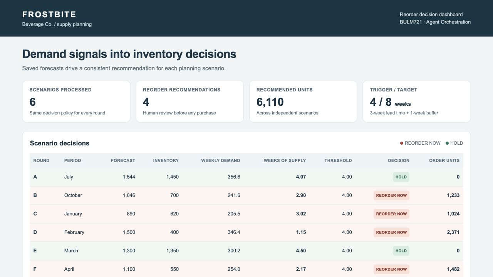

  

  <a href="https://xianyu-hw.github.io/ai-desktop-designer/?lang=en"><b>Enter the showcase ↗</b></a>
  &nbsp; · &nbsp;
  <a href="https://github.com/XIANYU-HW?tab=repositories">All projects</a>
  &nbsp; · &nbsp;
  <a href="https://xianyu-hw.github.io/ai-desktop-designer/?lang=zh-CN">中文展示</a>

I turn imagined worlds into desktop experiences, and everyday questions into small, useful tools.

我是清风作梦，喜欢把天马行空的念头做成可以亲手打开的作品。从奇幻桌面到数据看板，和 AI 一起边做边探索。

## Selected work · 作品

### 01 / AI Desktop Designer

**A world you love. A desktop you can live in.**

An AI skill for designing desktop worlds and everyday tools on Windows and macOS. Start with a scene; give it a place in your day.

<table>
  <tr>
    <td width="50%" valign="top">
      
       
      <b>Three-Body · Observatory</b> 
      A little order in an unpredictable world. 
      <a href="https://xianyu-hw.github.io/ai-desktop-designer/themes/threebody-observatory/?demo=1&amp;lang=en">Enter the observatory ↗</a>
    </td>
    <td width="50%" valign="top">
      
       
      <b>Sumeru · Garden of Knowledge</b> 
      A quiet place for thoughts to grow. 
      <a href="https://xianyu-hw.github.io/ai-desktop-designer/themes/genshin-sumeru/?demo=1&amp;lang=en">Step into the garden ↗</a>
    </td>
  </tr>
</table>

[**Explore the project →**](https://github.com/XIANYU-HW/ai-desktop-designer) &nbsp; · &nbsp; [中文说明](https://github.com/XIANYU-HW/ai-desktop-designer/blob/main/README.zh-CN.md)

Unofficial fan showcases. Browser demos use sample system data and do not operate your computer. · 非官方粉丝场景；浏览器演示使用样例数据，不操作本机。

---

### 02 / Frostbite Dashboard

**Making the numbers easier to see.**

A supply-planning coursework dashboard for exploring forecasts, weeks of supply, and reorder recommendations.

Coursework scenario snapshot · 课程场景快照

[**Open the dashboard ↗**](https://xianyu-hw.github.io/frostbite-dashboard/) &nbsp; · &nbsp; [View the project](https://github.com/XIANYU-HW/frostbite-dashboard)
